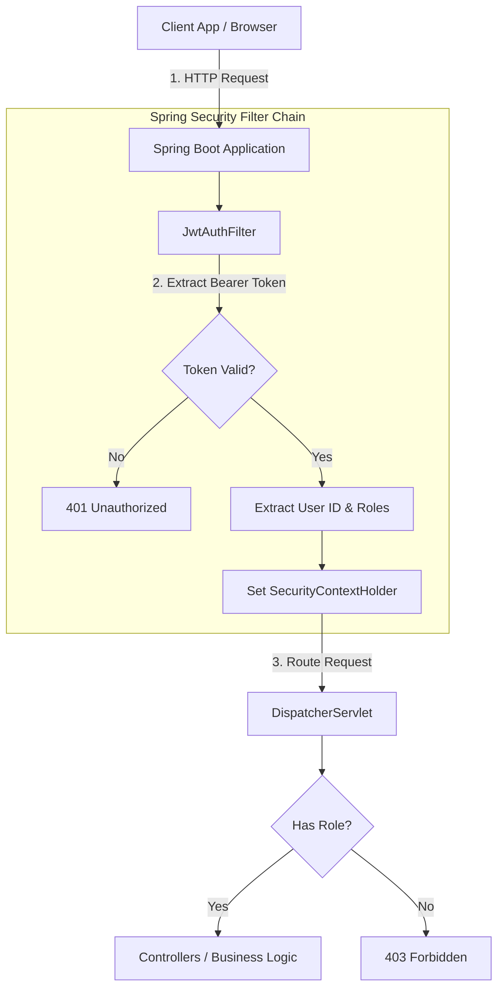
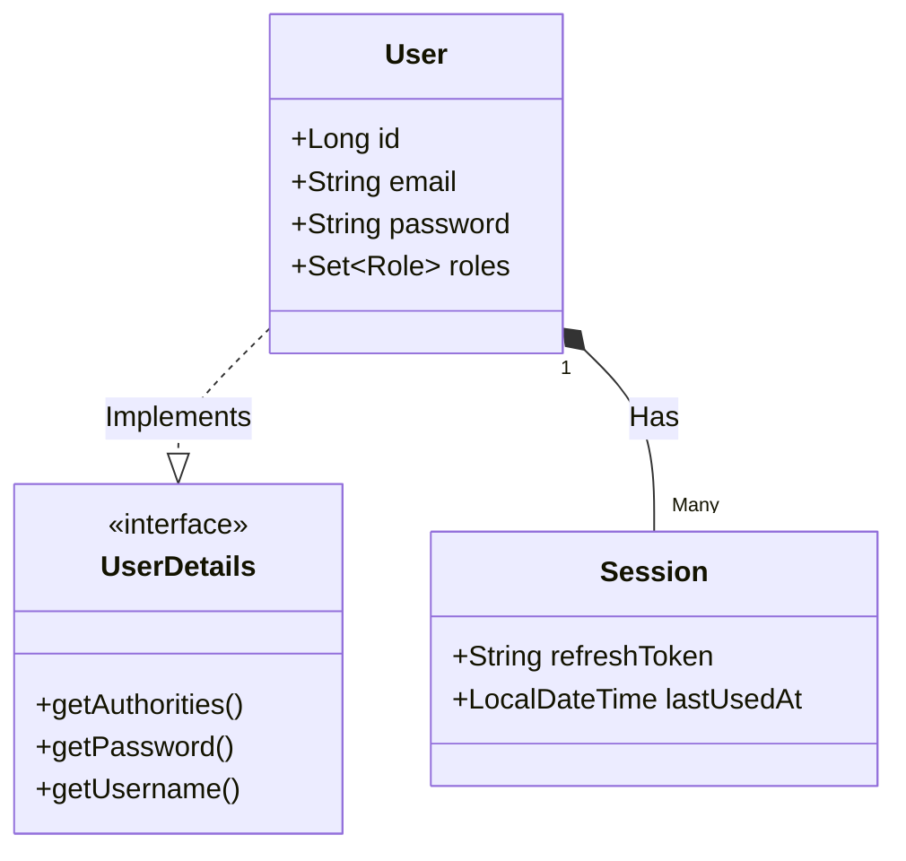
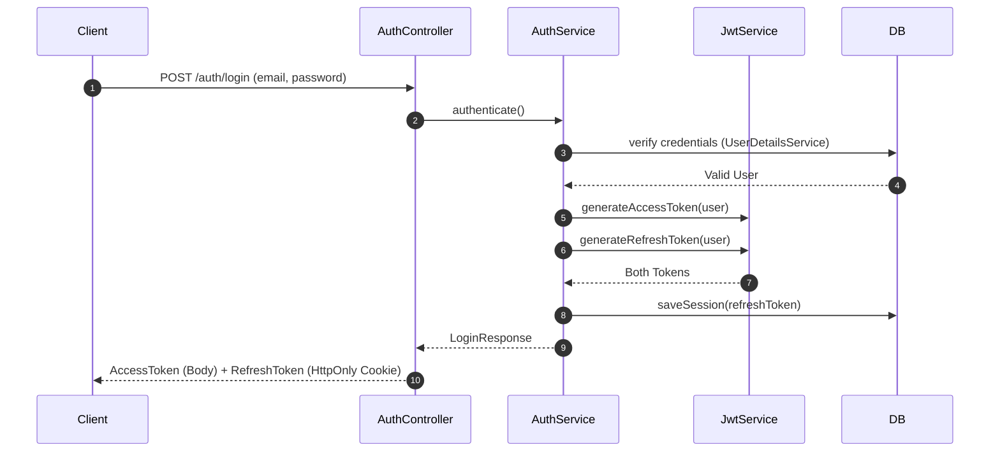
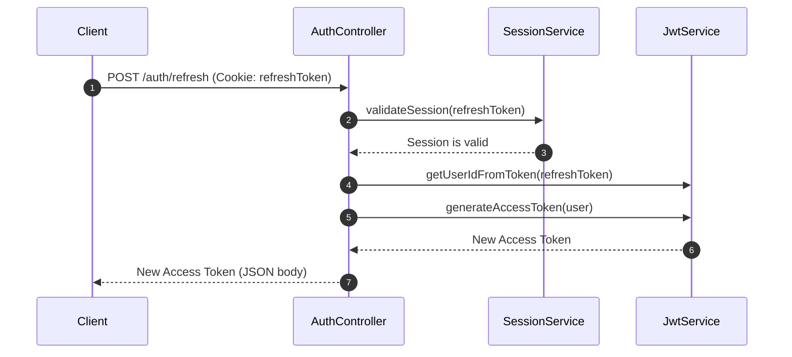
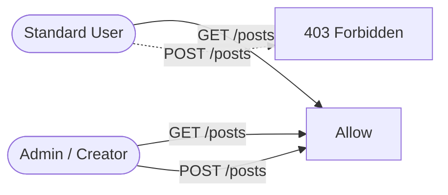

# Step-by-Step Guide: Implementing Spring Security with JWT

This guide provides a visual and step-by-step approach to implementing Authentication and Authorization in a Spring Boot application using JSON Web Tokens (JWT) and OAuth2.

---

## 1. High-Level Security Architecture

Before writing code, it's essential to understand how a request flows through the Spring Security filter chain.

---

## 2. The Implementation Steps

### Step 1: Add Required Dependencies
Start by adding the core Spring Security and JWT dependencies in your `pom.xml`.
* **Spring Boot Starter Security**: Core security framework.
* **Spring Boot Starter OAuth2 Client**: For social logins (Google, GitHub).
* **JJWT (io.jsonwebtoken)**: For generating and parsing JWTs.

### Step 2: Define Core Entities
You need a `User` entity that implements Spring Security's `UserDetails` interface.

### Step 3: Create the JWT Service (`JwtService.java`)
This service is responsible for securely generating and validating tokens using a secret key (HMAC-SHA).
* **Access Token:** Short lifespan (e.g., 10-15 mins). Contains roles and user info.
* **Refresh Token:** Long lifespan (e.g., 6 months). Only used to get new Access Tokens.

### Step 4: Implement the JWT Auth Filter (`JwtAuthFilter.java`)
This is a `OncePerRequestFilter`. It intercepts every incoming HTTP request.
1. Looks for the `Authorization: Bearer <token>` header.
2. Extracts and validates the token via `JwtService`.
3. Loads the user and populates the `SecurityContextHolder`.

---

## 3. Core Authentication Flows

### A. The Standard Login Flow
When a user logs in with their email and password, the system validates the credentials and returns two tokens. For maximum security, the Refresh Token is sent as an `HttpOnly` cookie.

### B. The Token Refresh Flow
When the Access Token expires (resulting in a 401 error), the client uses the Refresh Token to get a new one without forcing the user to log in again.

---

## 4. Role-Based Access Control (RBAC) Setup

Finally, configure route protections in your `WebSecurityConfig`.

**Implementation in `SecurityFilterChain`:**
* Use `requestMatchers(HttpMethod.GET, "/posts/**").permitAll()` to make reads public.
* Use `requestMatchers(HttpMethod.POST, "/posts/**").hasAnyRole("ADMIN", "CREATOR")` to restrict writes.
* Attach the `JwtAuthFilter` before the standard `UsernamePasswordAuthenticationFilter`.
* Set session management to `SessionCreationPolicy.STATELESS` (vital for JWTs).
